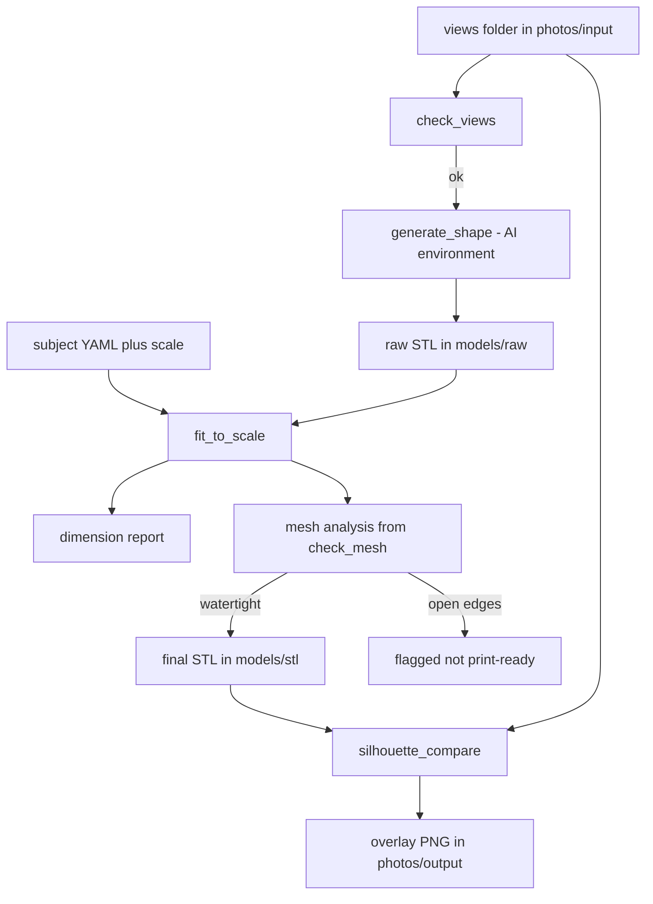

# Multiview Image-to-3D Model - Plan

## Goal Capsule

- **Objective:** From a handful of clean views of an object, the toolkit produces a printable 3D model whose overall length, width, and height match the real object at a chosen print scale. The first target is a 1:32 MINI Countryman, about 139 mm long.
- **Means:** Local multiview AI shape generation, then a measured correction to published dimensions (KTD1, KTD2).
- **Product authority:** The Product Contract below. Photogrammetry, textured output, and the lithophane and relief tools are not active scope.
- **Execution profile:** Python scripts in the existing toolkit style. The AI generator runs in a separate environment (KTD3). The first unit is a feasibility gate that can change the generator (KTD1).
- **Stop conditions:** Stop and report if U1 shows neither Hunyuan3D multiview nor TripoSR runs on this machine, or if no generator can meet the 2% bar on the Countryman after view recapture.
- **Tail ownership:** The user prints and judges the physical model. Executors stop at a verified STL and report.

---

## Product Contract

Preservation note: Product Contract unchanged. Dependencies, Outstanding Questions, and Sources were updated in place with research results.

### Summary

Add a repeatable path to the existing toolkit: a folder of clean car views goes in, and a generated shape-only mesh comes out. The mesh is scaled to the real car's dimensions at 1:32, checked against them, and delivered as an STL that passes the existing mesh check. Generation runs locally on the 8 GB RTX 5060 Laptop GPU.

### Problem Frame

The toolkit turns photos into lithophanes and relief panels but cannot make a freestanding model. The user's source material for the first model is seven screenshots of a MINI Countryman from a dealer configurator, not photos of an owned object. They are small 3/4-angle renders of mixed sizes. That rules out photogrammetry, which needs many consistent photos of a matte, textured subject. It also means AI generation cannot be trusted for true dimensions without a measured correction.

### Key Decisions

- **Goal is a dimensionally accurate scale model, not just a recognizable miniature.** (session-settled: user-directed — chosen over a printable display miniature: accuracy of real proportions matters.) Governs R5, R6, R7.
- **Target scale is 1:32, about 140 mm long.** (session-settled: user-directed — chosen over 1:24 and 1:43.) Governs R5.
- **Multiview AI generation plus measured correction.** (session-settled: user-directed — chosen over multiview-only, single-image-only, and checking for an existing mesh first: it is the only option that makes accuracy a checked result.) Governs R3, R5, R6.
- **Shape-only, local generation.** Textured Hunyuan3D needs about 16 GB of VRAM against the machine's 8 GB, and a single-color print does not need textures. Governs R3.
- **Multiview input needs clean front, back, left, and right views.** The existing 3/4-angle screenshots do not qualify. Governs R1, R2.

### Requirements

**Input**

- R1. Accept a folder of views of one object, at minimum clean front, back, left, and right, from `photos/input/`.
- R2. Give the user a capture checklist (views, matching sizes, plain background, high resolution) and say plainly when a supplied set falls short. The seven screenshots in `photos/input/3d Model Mini Cooper/` fall short.

**Generation**

- R3. Generate a shape-only 3D mesh from the views locally, on the 8 GB GPU, without uploading the images anywhere.
- R4. Keep generated meshes alongside the toolkit's other models, separate from the original images, which are never edited in place.

**Dimensional accuracy**

- R5. Scale the mesh to a stated print scale and a user-supplied or looked-up set of real-world length, width, and height for the subject.
- R6. Report the measured length, width, and height against their targets and pass only when each is within 2%.
- R7. Produce a silhouette comparison of the mesh against the supplied side and top views, so wheelbase and body proportions can be judged by eye. These are not pass/fail.

**Printability**

- R8. Deliver the result as an STL that passes `print_prep/check_mesh.py` (watertight, positive volume).
- R9. A new run for a different subject needs only its views, its real dimensions, and a scale.

**Baseline**

- R10. Allow an optional single-image run on one chosen view, so its result can be compared with the multiview result.

### Acceptance Examples

- AE1. **Covers R5, R6.** Given a generated mesh whose length is 4% off the target, when the correction runs, the output is rescaled and the report shows every dimension within 2%. If the shape cannot meet that, the report says which dimension fails.
- AE2. **Covers R1, R2.** Given the seven existing configurator screenshots, when the user submits them, the toolkit says that true front, back, left, and right views are missing and points to the capture checklist.
- AE3. **Covers R8.** Given a corrected mesh with open edges, when delivery runs, the result is flagged as not print-ready rather than silently exported.

### Success Criteria

- A 1:32 Countryman prints and reads as that car, with length, width, and height within 2% of the real car's.
- The same path works for a second object with no changes beyond new views, dimensions, and scale.

### Scope Boundaries

**Deferred for later**

- Photogrammetry with Meshroom, for objects the user photographs themselves.
- Textured or full-color output.
- Splitting a model into parts for small print beds, and slicer or support settings.

**Outside this plan**

- Lithophane and relief generation (LithoMaker and ImageToSTL equivalents), which the toolkit already covers.
- Exact wheelbase, ride height, or fine detail such as grille and wheel spokes. These are judged by eye only (R7).

#### Deferred to Follow-Up Work

- Per-trim dimension profiles for the Countryman (U3 stores one midpoint set).
- A guided capture helper that grabs configurator views automatically.

### Dependencies / Assumptions

- Published Countryman dimensions: length 4433-4447 mm, width 1843 mm, height 1635-1661 mm, wheelbase 2692 mm, varying by trim. These come from dealer-data sites, not an official MINI sheet, and the trim shown in the screenshots is not identified.
- Hunyuan3D-2 reports about 6 GB of VRAM for shape generation. No figure exists for the multiview variant (1.1B parameters). Fit in 8 GB is unverified until U1.
- Hunyuan3D multiview documents front, left, and back inputs. Whether a right view is accepted is unverified until U1.
- The RTX 5060 (Blackwell) needs a PyTorch build with CUDA 12.8 or newer (2.7 or later per PyTorch forum guidance). Whether Hunyuan3D runs on it under Windows with Python 3.12 is unverified until U1.
- Hunyuan3D's community license does not apply in the European Union, United Kingdom, or South Korea. The user is assumed to be outside them. (session-settled: user-approved — assumed over asking the user's location: the plan proceeds and README flags it.)
- The user's printer bed fits a roughly 139 mm part in one piece. Not confirmed.
- The images are of a MINI Countryman, while the user's folder name says "Mini Cooper". The Countryman dimensions are assumed.

### Outstanding Questions

**Resolve Before Planning**

- None.

**Deferred to Planning**

- None. Scaling method is KTD2, the dimension source is KTD4, and the 8 GB feasibility check is U1.

### Sources / Research

- `photos/input/3d Model Mini Cooper/`: seven configurator screenshots, 17-50 KB each, 3/4 views on a dark background.
- `print_prep/check_mesh.py`: existing STL check, reports size, watertightness, and volume.
- `README.md`, `config.yaml`: toolkit layout and defaults.
- Hardware seen in this session: NVIDIA GeForce RTX 5060 Laptop GPU, 8151 MiB; Python 3.12.10.
- Hunyuan3D-2 README (`https://github.com/Tencent-Hunyuan/Hunyuan3D-2`): multiview model `tencent/Hunyuan3D-2mv`, `--low_vram_mode`, mini 0.6B model, output as a trimesh object.
- Hunyuan3D-2mv model card (`https://huggingface.co/tencent/Hunyuan3D-2mv`): multiview call takes a dict of front, left, and back images, plus step and octree-resolution settings.
- Hunyuan3D license (`https://raw.githubusercontent.com/Tencent-Hunyuan/Hunyuan3D-2/main/LICENSE`): excludes the EU, UK, and South Korea.
- Countryman dimensions: CarExpert, CarsGuide, and CarSales listings via web search. Unofficial.
- PyTorch Blackwell guidance: PyTorch forum thread "Pytorch support for sm120" (`https://discuss.pytorch.org/t/pytorch-support-for-sm120/216099`).
- TripoSR (`https://github.com/VAST-AI-Research/TripoSR`) and Meshroom (`https://github.com/alicevision/meshroom`): user-supplied tool list.

---

## Planning Contract

### Key Technical Decisions

- KTD1. **Feasibility gate first, with a fallback generator.** Unit U1 runs Hunyuan3D multiview once on this machine before the rest is built. If it cannot run in 8 GB, the generator becomes TripoSR on a single view, built directly into U6 (U8 then only documents the multiview option), and the correction and checks are unchanged. (session-settled: user-approved — chosen over building the toolkit first and discovering the limit late: the VRAM and Blackwell questions are unverified.) Governs R3, R10.
- KTD2. **Correction scales the whole mesh uniformly to the target length, then checks width and height.** A per-axis stretch is applied only when width or height misses the 2% bar and the needed stretch is within a cap (default 5%, set in `config.yaml`); beyond the cap the run fails loudly. (session-settled: user-approved — chosen over unconstrained per-axis fitting: it keeps wheels round and proportions honest.) Governs R5, R6.
- KTD3. **The AI stack lives in its own Python environment, and an STL file is the handoff.** The generator writes a raw STL; every other script runs in the existing environment with Pillow, NumPy, numpy-stl, and PyYAML. (session-settled: user-approved — chosen over adding PyTorch to `requirements.txt`: the existing lithophane scripts stay light and PyTorch needs a GPU-specific build.) Governs R3, R4, R9.
- KTD4. **Real dimensions live in one YAML file per subject, with CLI overrides.** The file holds length, width, height, optional wheelbase (reference only), and a note naming its source. The Countryman file uses trim midpoints (length 4440, width 1843, height 1648 mm), which at 1:32 are about 138.8 x 57.6 x 51.5 mm. The trim spread is inside the 2% bar. (session-settled: user-approved — chosen over per-trim profiles: one set meets the bar and trim is unidentified.) Governs R5, R9.
- KTD5. **The generator cleans and orients its output; the fit step trusts the axes.** After generation, the generator script removes floating fragments, keeps the largest piece, fills small holes, and rotates the mesh so X is length, Y is width, Z is up. The fit script rejects a mesh whose extents contradict that order instead of guessing. The orientation convention comes from the U1 spike. Governs R3, R8.
- KTD6. **Silhouettes are rasterized with Pillow and shown as an overlay image, not scored.** Side views are near-orthographic at best, so R7 stays an eyeball aid. Governs R7.
- KTD7. **View sets use fixed file names.** A subject folder holds `front`, `back`, `left`, and `right` images, plus an optional `top`, in any common image format. Governs R1, R2.

### High-Level Technical Design

### Risks

- **VRAM or driver failure on the 8 GB Blackwell GPU.** Mitigated by the U1 gate, `--low_vram_mode`, the 0.6B mini model, and the TripoSR fallback (KTD1).
- **Generated shape is too wrong to correct.** A uniform rescale cannot fix a proportion error over the cap. The report names the failing dimension, and recapturing views or trying the baseline are the remedies.
- **Windows build problems.** Texture components need compilation, but shape-only generation does not use them, so U1 installs only what shape generation needs.
- **Tencent license.** Territory exclusion noted above; the README and setup doc state it.
- **Configurator views are perspective renders, not orthographic.** This limits both generation quality and the silhouette comparison. The capture checklist asks for the longest focal length the configurator offers.

---

## Implementation Units

### U1. Generation environment and feasibility gate

- **Goal:** Prove Hunyuan3D multiview shape generation runs on this machine in 8 GB, and record what the rest of the plan depends on.
- **Requirements:** R3.
- **Dependencies:** None.
- **Files:** `docs/IMAGE_TO_3D.md` (create), `model_scripts/requirements-gen.txt` (create), `.gitignore` (modify: `tools/`, `models/raw/`).
- **Approach:**
  1. Create the separate environment with a PyTorch build that supports the RTX 5060 (CUDA 12.8 or newer) and install the Hunyuan3D shape-generation parts from a clone under `tools/`.
  2. Run one multiview generation on any available views, using the low-VRAM options, and note peak VRAM.
  3. Find out whether a `right` view is accepted and which axis the output treats as up and as length.
  4. If it fails in 8 GB, try the mini model; if that also fails, record the decision to promote U8 per KTD1.
  5. Write the setup steps, the findings, and the license territory note into `docs/IMAGE_TO_3D.md`.
- **Execution note:** Smoke-first. Install and run before writing any other unit.
- **Test expectation:** none -- environment setup and manual feasibility run; its findings are recorded in the doc.
- **Verification:** The doc names the working PyTorch and CUDA versions, the peak VRAM, whether `right` is accepted, the output axis convention, and the go or fall-back decision.

### U2. Expose mesh analysis from the existing check

- **Goal:** Let other scripts reuse the watertight, volume, and size checks without changing what the command line prints.
- **Requirements:** R8.
- **Dependencies:** None.
- **Files:** `print_prep/check_mesh.py` (modify), `tests/test_check_mesh.py` (create), `requirements-dev.txt` (create, pytest).
- **Approach:**
  1. Split the analysis (triangles, size, open-edge count, volume) into a function that returns values.
  2. Have the existing `main` call it and print exactly as before.
- **Patterns to follow:** The existing `main` structure and output lines in `print_prep/check_mesh.py`.
- **Test scenarios:**
  - A closed cube STL reports watertight, positive volume, and the cube's size.
  - A cube with one face removed reports open edges.
  - A cube with inverted normals reports negative volume.
  - Covers AE3. The command-line exit code is 1 for the open and inverted cases and 0 for the closed one.
- **Verification:** Existing command-line behavior is unchanged on a known panel STL, and the tests pass.

### U3. Subject dimensions and scale settings

- **Goal:** Give each subject one file of real-world dimensions, and a default scale and tolerances in config.
- **Requirements:** R5, R9.
- **Dependencies:** None.
- **Files:** `model_scripts/subjects/mini_countryman.yaml` (create), `model_scripts/subject.py` (create), `config.yaml` (modify: add a `model` section with scale denominator 32, tolerance 2 percent, stretch cap 5 percent), `tests/test_subject.py` (create).
- **Approach:**
  1. Subject file holds length, width, height in mm, an optional wheelbase, and a source note (KTD4).
  2. A small loader merges the subject file, `config.yaml` defaults, and CLI overrides, following the loading pattern in `photo_scripts/make_lithophane.py`.
  3. Compute target print dimensions as real size divided by the scale denominator.
- **Patterns to follow:** `load_defaults` in `photo_scripts/make_lithophane.py`.
- **Test scenarios:**
  - Countryman values at 1:32 give about 138.8 x 57.6 x 51.5 mm.
  - A CLI scale override of 24 changes the targets accordingly.
  - A subject file missing the height raises a clear error naming the field.
  - Covers R9. A second subject file with different numbers loads with no code changes.
- **Verification:** Tests pass and the Countryman targets match the numbers in KTD4.

### U4. Fit mesh to scale and deliver the STL

- **Goal:** Scale a raw mesh to the target print size, report accuracy, and deliver a print-ready STL.
- **Requirements:** R5, R6, R8.
- **Dependencies:** U2, U3.
- **Files:** `model_scripts/fit_to_scale.py` (create), `tests/test_fit_to_scale.py` (create).
- **Approach:**
  1. Load the raw STL and read its extents; reject it with a clear message if the extents contradict the X-length, Y-width, Z-up order (KTD5).
  2. Scale uniformly so length meets the target, then compute the width and height errors.
  3. If either misses the tolerance, apply a per-axis stretch only when it is within the cap; otherwise fail and name the dimension (KTD2).
  4. Place the mesh on Z = 0, centered, write the STL to `models/stl/`, and run the U2 analysis.
  5. Print a table of target, measured, error percent, and pass or fail per dimension, plus the print-ready verdict.
- **Technical design:** Directional only. Uniform factor `s = target_length / length`; then `err_w = (s * width - target_width) / target_width` and likewise for height; stretch only if `|err|` exceeds the tolerance and the stretch needed is at most the cap.
- **Patterns to follow:** Argument parsing and `ROOT`-relative config loading in `photo_scripts/make_lithophane.py`.
- **Test scenarios:**
  - Covers AE1. A box 4% too long with correct proportions is rescaled and every dimension reports within 2%.
  - A box whose width is 3% off after the length rescale is stretched in Y and passes.
  - A box whose width is 12% off fails with the width named and no STL marked ready.
  - An input with Z longer than X is rejected with an orientation message.
  - Covers AE3. A mesh with open edges is written but reported as not print-ready, and the exit code is non-zero.
  - The output sits on Z = 0 and its measured size equals the reported size.
- **Verification:** The tests pass and a run on a synthetic car-shaped box produces a report whose numbers match its STL when checked with `print_prep/check_mesh.py`.

### U5. View-set validation and capture checklist

- **Goal:** Tell the user plainly whether a folder of views is usable and what to capture if it is not.
- **Requirements:** R1, R2.
- **Dependencies:** None.
- **Files:** `model_scripts/check_views.py` (create), `docs/IMAGE_TO_3D.md` (modify: add the capture checklist), `tests/test_check_views.py` (create).
- **Approach:**
  1. Look for `front`, `back`, `left`, `right`, and optional `top` image files (KTD7).
  2. Check matching pixel sizes, a minimum long edge, and a plain background by comparing corner colors to the border.
  3. Print each shortfall with the checklist line that fixes it; exit non-zero on any failure.
- **Test scenarios:**
  - Covers AE2. A folder of arbitrarily named screenshots reports missing front, back, left, and right and points to the checklist.
  - A complete set of four equal-size images on a flat background passes.
  - One image with different dimensions fails with the mismatching file named.
  - A cluttered-background image is flagged as not plain.
  - An optional `top` image is accepted when present and not required when absent.
- **Verification:** Running it on `photos/input/3d Model Mini Cooper/` fails with the missing-view message.

### U6. Shape generation script

- **Goal:** Turn a valid view set into a cleaned, oriented raw STL, locally.
- **Requirements:** R3, R4.
- **Dependencies:** U1, U5.
- **Files:** `model_scripts/generate_shape.py` (create), `models/raw/` (output, ignored by git), `tests/test_generate_postprocess.py` (create).
- **Approach:**
  1. Read the views using the same file names as U5 and pass them to the multiview pipeline with the low-VRAM settings U1 found to work.
  2. Post-process: drop floating fragments, keep the largest piece, fill small holes, and rotate to the X-length, Y-width, Z-up convention U1 recorded (KTD5).
  3. Write the raw STL to `models/raw/<subject>.stl` and print the extents.
  4. Never read or write the original images except to read them.
- **Execution note:** The generation call is verified by the manual run in U1's environment. Only the post-processing helpers are unit tested, and because they use `trimesh` from the AI environment (KTD3), their tests import it with a skip-if-missing guard so the main-environment test run stays green.
- **Test scenarios:**
  - Post-processing keeps only the larger of two disconnected boxes.
  - A mesh generated with Y as its longest axis is rotated so X is the longest.
  - A small hole in a closed mesh is filled and the result is watertight.
  - Running with an output path outside `models/raw/` still works but the default path is inside it.
- **Verification:** Using a real or recaptured view set, the script produces a raw STL that opens with the expected rough shape, and its peak VRAM stays under the U1 figure.

### U7. Silhouette comparison

- **Goal:** Show the user how the mesh outline compares with the supplied views.
- **Requirements:** R7.
- **Dependencies:** U4, U5.
- **Files:** `model_scripts/silhouette_compare.py` (create), `tests/test_silhouette_compare.py` (create).
- **Approach:**
  1. Project the final STL along the view axis and fill the triangles into a mask with Pillow (KTD6).
  2. Build a mask from each supplied view by separating it from its plain background, and scale both to the same width.
  3. Write an overlay PNG per view to `photos/output/` with the two outlines in different colors, and print the overlap fraction for information only.
- **Test scenarios:**
  - A box projected along Y produces a rectangle mask of the right aspect ratio.
  - A view image of the same box on a plain background overlaps the projected mask nearly fully.
  - A view of a clearly different shape produces a visibly lower overlap and still writes the overlay.
  - A missing `top` view is skipped without error.
- **Verification:** The overlay images open and show both outlines for each supplied side view.

### U8. Single-image baseline generator

- **Goal:** Let the user compare the multiview result with a one-view result, and serve as the fallback generator if U1 fails.
- **Requirements:** R10.
- **Dependencies:** U1, U6.
- **Files:** `model_scripts/generate_shape.py` (modify: add a baseline option that takes one view), `docs/IMAGE_TO_3D.md` (modify: baseline setup).
- **Approach:**
  1. Add a backend option that runs TripoSR on one chosen view and feeds the same post-processing and handoff as U6.
  2. Document its separate install in the same AI environment, or its own if packages conflict.
- **Execution note:** Best-effort. If TripoSR cannot be installed on Windows with the Blackwell GPU, record that in the doc and leave R10 open, unless U1 promoted this unit to the primary generator.
- **Test scenarios:**
  - Selecting the baseline without a view argument exits with a clear usage error.
  - The baseline output passes through the same orientation and cleanup helpers as the multiview output.
- **Verification:** A baseline STL from one Countryman view goes through U4 and U7 the same way as the multiview STL.

### U9. Docs and end-to-end run on the Countryman

- **Goal:** Make the path discoverable and prove it on the first target.
- **Requirements:** R1, R2, R4, R8, R9.
- **Dependencies:** U4, U5, U6, U7.
- **Files:** `README.md` (modify: quick start for the new path), `docs/WORKFLOW.md` (modify: add an image-to-3D section), `docs/IMAGE_TO_3D.md` (modify: final commands, expected report, license territory note).
- **Approach:**
  1. Document the five-step run: capture views, validate, generate, fit, compare.
  2. Using views the user recaptures from the configurator, run the whole path once and record the report and overlay in the doc.
- **Test expectation:** none -- documentation and a manual end-to-end run.
- **Verification:** The final report shows every dimension within 2% and the STL passes `print_prep/check_mesh.py`; the doc lists the capture checklist and the license note.

---

## Verification Contract

| Check | Command or action | Applies to |
|---|---|---|
| Unit tests | `python -m pytest tests -q` from the repo root, in the existing environment (U6 helper tests are skipped there) | U2, U3, U4, U5, U7 |
| Generator helper tests | The same command run in the AI environment, where U6's post-processing tests execute | U6 |
| Mesh check | `python print_prep/check_mesh.py models/stl/<name>.stl` reports watertight and the expected size | U4, U8, U9 |
| View check | `python model_scripts/check_views.py "photos/input/<folder>"` | U5, U9 |
| Generator smoke run | Run `model_scripts/generate_shape.py` in the AI environment on a real view set and note peak VRAM | U1, U6, U8 |
| Overlay review | Open the PNGs in `photos/output/` | U7, U9 |
| Dimension report | The `fit_to_scale` report lists every dimension within 2% | U4, U9 |

## Definition of Done

- Every unit's verification above has been met, and U1's findings are recorded in `docs/IMAGE_TO_3D.md`.
- `python -m pytest tests -q` passes in the existing environment, which still needs no AI packages, and passes with U6's helper tests running in the AI environment.
- A Countryman STL at 1:32 has length, width, and height each within 2% of the targets, passes `print_prep/check_mesh.py`, and has an overlay for each supplied view.
- A second subject needs only a new YAML file, views, and a scale (R9).
- Abandoned experiments, scratch scripts, and failed install attempts are removed from the diff. `tools/` and `models/raw/` are ignored, not committed.
