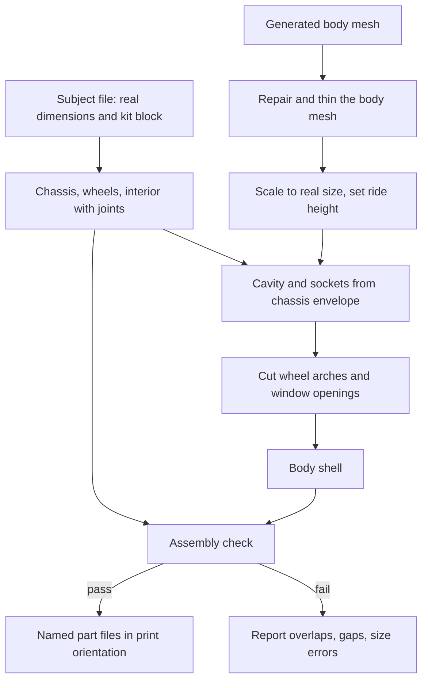

# Modular Car Kit Anatomy - Plan

## Goal Capsule

- **Objective:** A 1:24 MINI Countryman can be printed as separate parts and assembled into one car that fits together and matches the real car's dimensions.
- **Means:** The chassis, wheels and interior are sized from the car's real dimensions. The generated body shell is trimmed to fit them (chassis-first Key Decision).
- **Product authority:** The user. This plan covers the anatomy of one car kit only. The parts catalogue and order flow, and the work of making the generated body more accurate, are not active scope.
- **Open blockers:** None.
- **Product Contract preservation:** unchanged.
- **Execution profile:** code, in the AI environment (`tools/venv-gen`); each unit lands as its own commit, and nothing in the existing photo-to-mesh pipeline changes except a new `kit:` config section.

---

## Product Contract

### Summary

A kit for one car at 1:24, made for an Elegoo Centauri Carbon 2. A parametric chassis, static wheels and an interior are sized from the car's real dimensions. The generated body is hollowed, opened at the windows and trimmed to wrap them. The kit is done when the parts fit together and the assembled car matches the real car's dimensions.

### Problem Frame

The image-to-3D pipeline produces one fused mesh of a car. Its proportions are wrong by 20-35% in width and by up to 10% in height, it has no interior, and its wheels come out as separate pieces or fused into the body, with no mounts. A single mesh cannot be fixed one part at a time, and a precise 2% dimension bar is out of reach for a generator working from photos.

Splitting the car into separate printed parts follows common model-car practice. It lets the chassis, wheels and interior be exact while the body supplies the shape and surface detail the photos carry.

### Key Decisions

- **Body reshaped freely.** The body shell may be squeezed or stretched as far as the fit needs, while the wheels, chassis and interior stay at exact size. (session-settled: user-directed — chosen over keeping the 5% stretch cap and over an all-parametric body: the generated body is 20-35% off, so a 5% cap would block the kit, and the shell is the one part where distorted curves cost little.) Governs R8.
- **Chassis-first.** The real dimensions fix the chassis, wheels and interior, and the body is fitted to them. (session-settled: user-directed — chosen over body-first sizing and an all-parametric body: body-first misses the real-dimension test, and all-parametric gives up the generated body's shape and detail.) Governs R4, R8, R11.
- **1:24 scale.** (session-settled: user-directed — chosen over 1:32 and 1:18: a 0.4 mm nozzle handles wheels, mirrors and interior parts better at 1:24, and 1:18 nearly fills the bed.) Governs R2, R12.
- **Static display wheels.** (session-settled: user-directed — chosen over rolling wheels: no axle gaps or clearance engineering.) Governs R5.
- **Open windows with a visible interior.** (session-settled: user-directed — chosen over solid glass and a printed clear insert.) Governs R7, R8.
- **Parametric parts designed in this project.** (session-settled: user-directed — chosen over downloaded models and parts cut from the AI mesh: downloads need resizing and licence checks, and the AI mesh has no mounts or interior.) Governs R4, R6, R7.

### How This Work Fits Together

<!-- ce-section: work-relationships -->

This plan covers the kit anatomy for one car. The breakdown below is the current understanding, not a committed roadmap.

- Kit anatomy (this plan): the parts of one car, how they join, and the checks that they fit.
  - Parts catalogue and order: choosing a car, wheel style and interior to get a print list. Depends on this plan fixing the part interfaces. Still to decide.
  - Body quality: making the generated body shell more accurate and detailed. Shares the body-fitting step with this plan, and can proceed independently of the part design.

### Requirements

**Parts and printing**

- R1. The kit for one car is a body shell, a chassis, four wheels and an interior, each printable as its own part.
- R2. Every part prints on a Centauri Carbon 2 (256 mm cube bed, 0.4 mm nozzle, single colour) at 1:24.
- R3. Each part exports as its own named file, watertight with consistent winding, and the existing mesh check passes on it.

**Chassis, wheels and interior**

- R4. The chassis, wheels and interior are generated from the car's real dimensions (overall size, wheelbase, track width, ride height), never from the generated body.
- R5. Wheels are static display wheels fixed to the chassis, with no moving joints.
- R6. Wheel styles are variants of one wheel design that share the same mounting to the chassis, so changing the style needs no change to the chassis or the body.
- R7. The interior sits in the chassis and is visible through the open windows, with at least seats and a dashboard.

**Body shell**

- R8. The generated body is conformed to the chassis: hollow, with wheel arches sized and placed to the wheels, ride height set, and the window areas open. The 5% stretch cap does not apply to the shell.
- R9. The body shell seats on the chassis in one position without sanding, and is fixed with glue or screws.
- R10. Every joint has a stated print clearance, and the joint is proved with a test print before the full kit is printed.

**Checks**

- R11. The assembled kit's length, width and height are each within 2% of the real car's dimensions at 1:24.
- R12. The dimension targets used by the existing pipeline can be set for 1:24.
- R13. A check before printing reports parts that overlap or leave gaps beyond the stated clearance at the joins.

### Acceptance Examples

- AE1. **Covers R8, R11.** Given a generated body 25% wider than the real car, when it is conformed to the chassis, then the shell's width is within 2% of the target and the shell seats on the chassis.
- AE2. **Covers R6.** Given a finished kit, when the wheel style is changed, then the chassis and body files are unchanged and the new wheels still mount.
- AE3. **Covers R9, R10.** Given the first printed joint test, when the body seats on the chassis with no sanding, then the full kit is printed; when it does not, the clearance is revised and the joint is printed again.

### Success Criteria

- The first Countryman kit goes together without sanding or cutting.
- The assembled car's length, width and height match the real car within 2%.

### Scope Boundaries

**Deferred for later**

- The parts catalogue and the choose-a-car-and-options flow.
- Making the generated body itself more accurate or detailed.
- Cars other than the Countryman.
- Painting and finishing.
- Multi-colour printing, which needs the Combo version of the printer.
- A clear glazing insert for the windows.

**Outside this plan**

- Rolling wheels, axles, opening doors, and other moving parts.

### Dependencies / Assumptions

- The Countryman subject file records length, width, height and wheelbase only, so track width and ride height must be added (`model_scripts/subjects/mini_countryman.yaml`).
- The body comes from the existing image-to-3D pipeline, whose generated width has been 20-35% too wide on the current photo set.
- The printer is a single-colour Centauri Carbon 2. Four-colour printing needs the Combo version, which is assumed absent.
- The Hunyuan3D licence does not apply in the EU, UK or South Korea.

### Outstanding Questions

**Deferred to Planning**

- How the body shell's distorted wheel arches and surface detail are kept presentable after a large reshape.
- Whether the real width target counts the mirrors. The spec width of 1843 mm is without mirrors, and the generated body includes them.
- The join method (glue, screws or both), the print clearance, and the shell wall thickness.
- How each part is oriented for printing, and where the body is split if it does not print well as one piece.

### Sources / Research

- `docs/plans/2026-10-20-2127-feat-multiview-image-to-3d-model-plan.md`: the pipeline this kit builds on, including the 2% dimension bar and 5% stretch cap.
- `model_scripts/subjects/mini_countryman.yaml`: the current real-dimension record.
- `config.yaml`: model scale denominator (32), tolerance (2%) and stretch cap (5%).
- `freecad_scripts/litho_frame.py`: an existing parametric part script in this project.
- Elegoo Centauri Carbon 2 specifications: 256 x 256 x 256 mm build volume, 0.4 mm hardened nozzle, enclosed (https://3dpros.com/printers/elegoo-centauri-carbon-2).
- The user's research notes on separate body, chassis, wheel and interior printing; split parts improve orientation, supports and finish; AI-generated models are starting geometry, not assembly-ready kits.

---

## Planning Contract

### Key Technical Decisions

- KTD1. **Parts are built in Python on meshes, in the AI environment, not in FreeCAD.** `trimesh` with the `manifold3d` boolean engine can cut the dense generated body, runs headless, and takes the same tests as the rest of the pipeline. FreeCAD is installed but off the path, and its mesh booleans are fragile on a 300,000-triangle body. Every exported STL still opens in FreeCAD. (session-settled: user-approved — chosen over FreeCAD-scripted parts: FreeCAD cannot reliably cut the generated body and is not testable headless.) Governs R4, R7, R8.
- KTD2. **Everything lives in one assembled coordinate frame.** Origin on the ground plane under the car's centre, X length, Y width, Z up, as the existing fit step already orients bodies. Parts are authored and checked in that frame and only moved to a print orientation at export, so overlap and gap checks need no per-part alignment. Governs R3, R13.
- KTD3. **The body gets a cavity subtracted, not a uniform shell offset.** The cavity is shaped from the chassis envelope plus the interior's clearance, so the wall is uneven but the cut is a single reliable boolean on a messy generated mesh. (session-settled: user-approved — chosen over a uniform inward offset shell: offsetting a non-manifold AI mesh is the riskiest step and the shell is fitted to the chassis anyway.) Governs R8, R9.
- KTD4. **Window openings and wheel arches come from per-car positions in the spec file.** The values are measured off the silhouette overlays and tuned by eye, not detected from the mesh. (session-settled: user-approved — chosen over automatic detection: the generated glass and arches are not separate surfaces to find.) Governs R8.
- KTD5. **The body's width is measured on a body section below the mirrors, not on its bounding box.** The spec width of 1843 mm excludes mirrors, and the generated body includes them, so a bounding-box fit would squeeze the body too far. The body is then scaled non-uniformly to the real length, width and height, with the 5% stretch cap not applied to the shell (the settled Key Decision above). Governs R8, R11.
- KTD6. **The record of real dimensions grows a `kit` block with a source note per value.** Track width, wheel and tyre size, ride height and axle positions are looked up from official sources; any value that cannot be verified is marked unverified in the file and reported by the kit run. (session-settled: user-approved — chosen over asking you for each number first: the lookup is quick, and unverified values are named rather than hidden.) Governs R4, R11.
- KTD7. **A new `kit:` config section carries the 1:24 scale, the joint clearance and the printer bed size.** The existing `model:` section stays at 1:32 so the current pipeline and its tests are unchanged. Governs R2, R10, R12.
- KTD8. **Joints are fixed locating features plus glue.** Chassis pins seat in body sockets, the interior sits on chassis posts, and each wheel plugs onto a chassis stub. One global clearance value applies to every joint, with a per-joint override, and the number is proved by a coupon print. Governs R5, R9, R10.
- KTD9. **Each part is validated with the existing mesh check and a new assembly check.** The mesh check proves each part is watertight with consistent winding. The assembly check proves the parts do not collide and the joints sit within clearance. Governs R3, R13.

### High-Level Technical Design

The kit runs as one pipeline from the generated body and the real-dimension record to a folder of print-ready parts.

### System-Wide Impact

- The existing photo-to-mesh scripts, tests and 1:32 config are untouched. Kit scripts read the generated body but never write to the image-to-3D outputs.
- The kit scripts need the AI environment (`trimesh`, plus a mesh boolean engine), not the main Python environment, so their tests skip where those are absent, as the existing generation tests do.
- Output parts land under `models/kit/`, which the existing ignore rules already keep out of git.

### Alternative Approaches Considered

- **FreeCAD-scripted parametric parts**, following the existing frame script. Rejected: the body cut is mesh work FreeCAD does poorly, and its scripts can't run in the test suite.
- **B-rep CAD in Python (CadQuery)** for the parts and a mesh route for the body. Rejected: a second geometry kernel and a heavy dependency for parts that are simple solids.
- **Uniform shell by inward offset.** Kept as a later improvement; see the cavity decision above.

### Risks & Dependencies

| Risk | Effect | Mitigation |
|---|---|---|
| The generated body is not clean enough for boolean cuts | The cavity or window cut fails or leaves holes | The first unit proves it on the real body, with repair and thinning ahead of any cut |
| A 20-35% reshape leaves wheel arches and curves looking wrong | Body looks off even though dimensions pass | Wheel arches are cut after the reshape from the spec, and the silhouette overlay is checked by eye |
| Joint clearances that work on one printer fail on another | Parts jam or rattle | The coupon print proves the clearance on this printer before the full kit |
| Real-dimension values are unverified | Chassis and body disagree with the real car | Each value carries a source note, and unverified ones are reported on every run |
| The boolean engine has no wheel for this Python | The kit cannot cut meshes | The first unit installs and exercises it before any other unit relies on it |

---

## Implementation Units

### U1. Mesh cut-and-combine foundation

- **Goal:** Prove that the generated body can be repaired, thinned and boolean-cut, and give the rest of the kit one place for those operations.
- **Requirements:** R8, R13; KTD1.
- **Dependencies:** none.
- **Files:** `model_scripts/kit_mesh.py` (create), `model_scripts/requirements-gen.txt` (modify, add `manifold3d`), `tests/test_kit_mesh.py` (create).
- **Approach:**
  - Load an STL into a mesh, run the existing repair step from `model_scripts/generate_shape.py`, and thin it to a target triangle count.
  - Wrap union, subtract and intersect so a non-watertight input raises a clear error naming the part.
  - Install `manifold3d` into `tools/venv-gen`, confirm it has a build for that environment's Python, and record its version in the requirements file.
- **Execution note:** Start with a throwaway proof on the real generated body (`models/raw/countryman_w384.stl`) before writing the wrapper: subtract a box from it, and confirm the result is watertight. If the engine cannot do it, stop and raise it, because the rest of the plan rests on this.
- **Patterns to follow:** the mesh helpers and repair step in `model_scripts/generate_shape.py`; the importorskip pattern in `tests/test_generate_postprocess.py`.
- **Test scenarios:**
  - Happy path: subtracting a small box from a watertight box returns a watertight mesh with less volume.
  - Happy path: thinning a dense sphere to a target count stays within 2% of the original volume.
  - Edge case: subtracting a box that does not touch the body returns the body unchanged.
  - Error path: a mesh with a missing face is repaired, and one that cannot be repaired raises an error naming the part.
- **Verification:** the engine imports in the AI environment, and the real body survives a cut and stays watertight.

### U2. Kit spec and 1:24 config

- **Goal:** Record the real numbers the kit needs, and load them with the same subject loader the pipeline already uses.
- **Requirements:** R4, R11, R12; KTD6, KTD7.
- **Dependencies:** none.
- **Files:** `model_scripts/subject.py` (modify), `model_scripts/subjects/mini_countryman.yaml` (modify), `config.yaml` (modify), `tests/test_subject.py` (modify).
- **Approach:**
  - Add a `kit` block to the subject file: track widths, wheel and tyre diameter and width, ride height, axle positions from the front, and window and wheel-arch positions as fractions of length, each with a source note.
  - Look the values up from official MINI figures first, then the photo overlays; mark anything unverified with a flag the kit run reports.
  - Add a `kit:` config section for scale 1:24, joint clearance, and bed size 256 mm, leaving `model:` at 1:32.
  - Make the loader return the kit block when present and ignore it when absent, so the existing lithophane and pipeline subjects still load.
- **Patterns to follow:** the existing field checks and override behaviour in `model_scripts/subject.py`.
- **Test scenarios:**
  - Happy path: the Countryman subject returns the kit block with a source note on every value.
  - Edge case: a subject file with no kit block still loads for the existing pipeline.
  - Error path: a kit block missing track width raises an error naming that field.
  - Integration: the kit config section reads 1:24 while the `model:` section still reads 1:32.
- **Verification:** the existing subject tests still pass unchanged and the new ones cover the kit block.

### U3. Chassis, wheels, interior and joints

- **Goal:** Generate the parts that never come from the photos, sized from the spec, with joints that carry the clearance.
- **Requirements:** R1, R4, R5, R6, R7, R10; KTD2, KTD8.
- **Dependencies:** U1, U2.
- **Files:** `model_scripts/kit_parts.py` (create), `tests/test_kit_parts.py` (create).
- **Approach:**
  - Build a chassis plate carrying axle stubs, body pins and interior posts, from wheelbase, track, ride height and body width.
  - Build one wheel design with at least two styles that share the same hub socket, so a style change touches no other part.
  - Build a simple interior: floor, two front seats, a rear bench and a dashboard, sized to the cabin from the spec.
  - Apply the global joint clearance to every plug and socket, with a per-joint override.
  - Author all parts in the shared assembled frame.
- **Technical design:** the wheel profile is one revolved cross-section plus a style-specific spoke or disc cut; both styles keep the same hub socket diameter. Directional only.
- **Patterns to follow:** the parametric sizing style in `freecad_scripts/litho_frame.py`.
- **Test scenarios:**
  - Happy path: every part is watertight with consistent winding, as the existing mesh check judges it.
  - Happy path: both wheel styles fit the same chassis stub without any change to the chassis.
  - Edge case: raising the clearance value widens every socket and leaves every pin unchanged.
  - Edge case: a per-joint override changes only that joint.
  - Error path: a track width wider than the body width raises an error before any part is built.
- **Verification:** all parts pass the mesh check, and the wheel styles swap without the chassis changing.

### U4. Body conforming

- **Goal:** Turn the generated body into a shell that fits the chassis and has open windows.
- **Requirements:** R8, R9, R11; KTD3, KTD4, KTD5.
- **Dependencies:** U1, U2, U3.
- **Files:** `model_scripts/kit_body.py` (create), `tests/test_kit_body.py` (create).
- **Approach:**
  - Prepare the body mesh and orient it as the existing fit step does.
  - Measure width on a section below the mirrors, then scale non-uniformly to the real length, width and height at 1:24.
  - Set ride height, then cut the cavity from the chassis envelope and the sockets from the chassis pins.
  - Cut the wheel arches from the wheel size and positions, and the window openings from the spec's window positions.
- **Execution note:** Check the result by eye on the real body with the silhouette overlay after the arches and windows are cut, and tune the spec's positions rather than adding detection logic.
- **Patterns to follow:** the orientation and force-fit logic in `model_scripts/fit_to_scale.py` and `model_scripts/generate_shape.py`.
- **Test scenarios:**
  - Covers AE1. A synthetic body 25% too wide, with a mirror-like protrusion, is conformed to within 2% of the target width, measured below the mirror.
  - Happy path: the shell has an empty cavity under the roof and sockets where the chassis pins land.
  - Edge case: a body already at the right size is scaled by 1.0 and otherwise unchanged.
  - Error path: a window position outside the body's extent raises an error naming the window.
  - Integration: the conformed shell and the generated chassis share a frame, so a chassis pin lies inside its socket.
- **Verification:** the shell is watertight, has open windows, and its size is within 2% of the spec on all three axes.

### U5. Assembly check

- **Goal:** Report whether the parts fit before anything is printed.
- **Requirements:** R2, R3, R9, R11, R13; KTD2, KTD9.
- **Dependencies:** U3, U4.
- **Files:** `model_scripts/kit_check.py` (create), `tests/test_kit_check.py` (create).
- **Approach:**
  - Place every part in the shared frame and compute pairwise overlap volume and the gap at each mating joint.
  - Flag overlap beyond a tolerance and gaps beyond the clearance, and report overall length, width and height against the spec.
  - Check each part against the bed size in its print orientation, and run the existing mesh check on each part.
  - Return a non-zero exit code on any failure, following the exit-code style of the fit step.
- **Patterns to follow:** the report and exit codes in `model_scripts/fit_to_scale.py`; the mesh analysis in `print_prep/check_mesh.py`.
- **Test scenarios:**
  - Happy path: a correctly seated pin and socket pair reports a gap equal to the clearance and passes.
  - Edge case: a pin shifted 0.3 mm into the socket wall reports an overlap and fails.
  - Edge case: a part larger than the bed in every orientation fails the bed check naming the part.
  - Error path: a part that is not watertight fails the mesh check and the report names it.
  - Integration: the overall size reported matches the spec within 2% for a correctly built kit.
- **Verification:** a good kit passes, and each deliberately broken case fails with a named cause.

### U6. Kit command and documentation

- **Goal:** Run the whole kit from one command and explain it.
- **Requirements:** R1, R2, R3, R12; KTD7.
- **Dependencies:** U4, U5.
- **Files:** `model_scripts/make_kit.py` (create), `docs/CAR_KIT.md` (create), `docs/WORKFLOW.md` (modify), `tests/test_make_kit.py` (create).
- **Approach:**
  - Take a generated body and a subject name, run the parts, body and check steps, and write one named STL per part into `models/kit/<name>/` in its print orientation.
  - Print the assembly report, list any unverified spec values, and exit non-zero if the check fails.
  - Give each part a default print orientation, recorded in the `kit:` config section: chassis flat, wheels on their sides, interior floor down, body roof down. Refine these after the first prints.
  - Document the run, the part list, the printer settings that matter and the build order in `docs/CAR_KIT.md`, and link it from the workflow doc.
- **Patterns to follow:** the command-line shape in `model_scripts/generate_shape.py` and `model_scripts/fit_to_scale.py`.
- **Test scenarios:**
  - Happy path: a synthetic body and the Countryman subject produce one file per part and exit 0.
  - Edge case: running with `--scale 32` still produces a kit, scaled to 1:32.
  - Error path: a missing body file exits non-zero and names the path.
  - Error path: a failed assembly check exits non-zero and writes no part files.
- **Verification:** on the real generated body the command finishes, prints the report, and the files open in the slicer.

### U7. Joint test coupon

- **Goal:** Produce a small print that proves the joint clearance on your printer before the full kit.
- **Requirements:** R9, R10; KTD8.
- **Dependencies:** U3.
- **Files:** `model_scripts/joint_coupon.py` (create), `docs/CAR_KIT.md` (modify), `tests/test_joint_coupon.py` (create).
- **Approach:**
  - Generate a coupon with the kit's pin-and-socket and wheel-stub joints repeated at stepped clearances around the configured value.
  - Label each step by clearance with a notch count that survives printing, and add the print-and-fit procedure to the docs.
- **Patterns to follow:** the stepped test strip in `print_prep/test_strip.py`.
- **Test scenarios:**
  - Happy path: the coupon has one joint per clearance step and is watertight.
  - Edge case: the clearance range is centred on the configured value and stays positive.
  - Error path: a step count below two raises an error.
- **Verification:** the coupon prints on the Centauri Carbon 2, and the step that seats without sanding is recorded as the kit clearance.

---

## Verification Contract

| Gate | Command | Applies to |
|---|---|---|
| Main test suite | `python -m pytest tests -q` | Every unit; the kit tests skip where the AI environment is absent |
| AI-environment tests | `tools/venv-gen/Scripts/python -m pytest tests -q -p no:cacheprovider` | U1, U3, U4, U5, U6, U7 |
| Real-body proof | run the kit command on `models/raw/countryman_w384.stl` | U1 and U6 |
| Silhouette check | `python model_scripts/silhouette_compare.py` on the kit's assembled body against the prepared views | U4 |
| Mesh check | `python print_prep/check_mesh.py` on every exported part | U6 |
| Joint coupon print | print and fit the coupon on the Centauri Carbon 2 | U7 and the final kit |

## Definition of Done

**Global**

- Every requirement has a unit that implements it and a test or check that proves it.
- The assembly check passes on a Countryman kit built from the real generated body, with overall length, width and height within 2% of the 1:24 targets.
- The existing 1:32 pipeline tests pass unchanged.
- No dead-end or experimental code from abandoned attempts remains in the diff.

**Per unit**

- U1: the engine imports, and a cut on the real body stays watertight.
- U2: the Countryman kit block is complete with source notes and unverified values flagged.
- U3: every part is watertight and the wheel styles swap without a chassis change.
- U4: the shell is watertight, has open windows, and is within 2% on all axes.
- U5: a good kit passes and each broken case fails with a named cause.
- U6: one command produces the named part files and the report.
- U7: the coupon prints and its best step is recorded as the clearance.
